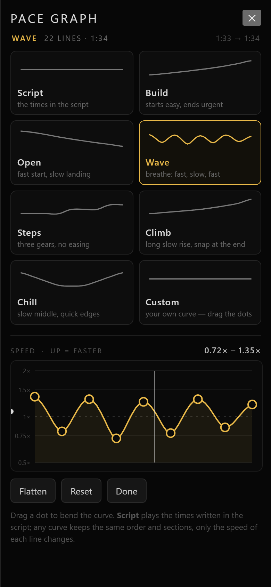
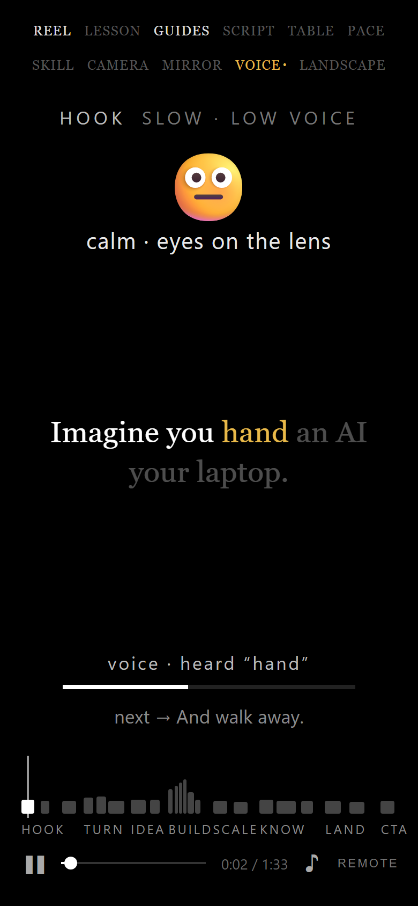
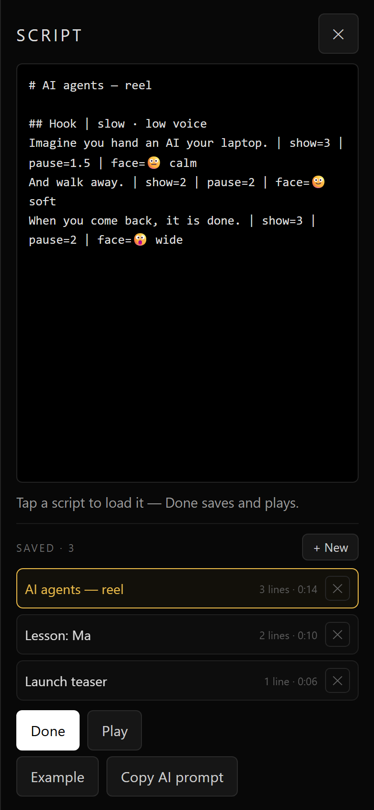

# 間 — Reel pacing · Remote control

Control the prompter from a second phone, tablet or laptop — **no account, no keys, and no need to be on the same Wi-Fi.**

Open **https://mdnadeemm.github.io/ma-prompter/** on both devices. That's the whole setup.

  
  

The file also runs offline: open `index.html` directly and pair with the code instead of the QR.

---

## Pair in 15 seconds

**On the prompter (the screen people read from)**

1. Tap **Remote** in the bottom-right corner.
2. Point the other device's camera at the **QR code** — the link opens and pairs itself.
3. No camera? Read the 5-character **room code** (e.g. `NAAUL`) and type it on the remote.

**On the remote (your phone)**

1. Scan the QR, or open the same page and tap **Remote → Use this device as the remote**, then type the code.
2. The dot turns green and says **linked**.

The code is remembered, so the next time both devices reconnect on their own.

---

## What the remote can do

| Control | Effect on the prompter |
|---|---|
| ▶ / ❚❚ (big button) | start / pause |
| ⟲ | back to the top and play |
| ■ | stop and rewind |
| −5 / +5 | jump 5 seconds |
| drag the progress bar | scrub to any point |
| Reel / Lesson / Mine | switch the script |
| a saved script chip | load that saved script and switch to Mine |
| Sound | mute the pulse sound |
| Camera | camera backdrop off → faint → strong |
| Flip | mirror the text (for a beam splitter) |
| Guides | hide/show the timing guides |
| Landscape | full-width stage with the biggest type that fits — for reading from far away |

The remote also shows the current line, the next line, the clock and the section, so you can read along.

Every script you have saved on the prompter appears on the remote as a row of chips just below Reel / Lesson / Mine — the one that is loaded is gold. Tap another one and the prompter loads it, switches to **Mine** and waits at the top of the script, so you can change the whole take from your phone without touching the prompter. The list belongs to the prompter: save or delete a script there and the remote row follows. Tapping the chip that is already loaded does nothing, so a stray tap cannot reset a take that is running. If there are no saved scripts the row is not shown at all.

Both devices stay in sync in both directions — if you tap the screen itself, the remote updates too.

---

## Read it from a distance

The normal stage is portrait-shaped, so on a phone propped up a few metres away the words are small. Tap **Landscape** in the top bar (or the **Landscape** chip on the remote) and the stage goes edge to edge and the type grows to the largest size that still fits the line — up to three lines, never breaking a word.

In this mode only the words remain: the face prompt, the speed readout, the progress line and the word map step aside. Spoken words stay white, words you have not reached yet drop to a third of their brightness, and the word you are on right now is gold — so from far away you can always see exactly where you are in the line. The mode bar and the controls fade out as usual and come back on a tap.

The choice is saved per device, so a phone that lives on a tripod comes back in landscape, and **W** toggles it from a keyboard.

  

---

## Rehearse first: the table

Tap **Table** in the top bar (or press **T**) for a rehearsal sheet of the whole script — one row per line with its **time**, the **line** itself, the **face / delivery** cue and how long it stays up (**show + pause**). Sections are grouped with their direction, e.g. *Build — fast · each line quicker*, so you can read the whole thing once and know where the voice changes before you start.

- Tap any row to jump the prompter to that line; it stays paused so you can read it, then tap the screen to play.
- The row for the line you are on is marked in gold and follows along while it plays.
- Lesson and custom scripts get the expression from their section direction when a line has no `face=`, so no row is ever empty.

  

---

## Change the pace with a graph

Every line already carries its own `show` and `pause`, and by default the prompter plays exactly those. Tap **Pace** in the top bar (or press **P**) and you can ride a curve instead — the words appear and disappear faster or slower as the film goes on, and the lines still keep their order, sections and faces.

The panel lists ready-made curves, each with its own little graph: **Build** (starts easy, ends urgent), **Open** (fast start, slow landing), **Wave** (breathe: fast–slow–fast), **Steps** (three gears, no easing), **Climb** (long slow rise, snap at the end) and **Chill** (slow middle, quick edges). Tap one and it plays immediately — the header shows the new total, e.g. *1:33 → 1:27*.

Underneath is the graph itself: nine dots on a speed axis from **0.5×** (half speed) to **2×** (double). Drag a dot up to speed that part of the film up, down to stretch it out; the whole line of dots bends into a smooth curve and the timing updates while you drag. The white playhead walks along the curve as the prompter plays, so you can see which part of the pace you are in.

- **Flatten** turns the current curve into a straight 1× line; **Reset** goes back to the script's own timings (**Script**).
- The curve applies to Reel, Lesson and your own script alike, and the choice is saved on this device.
- The script is never rewritten — the rehearsal table always shows the real, paced `show + pause` values.
- Turning the curve off restores the written timings exactly.

  

---

## Follow your voice

Sometimes the words come out faster or slower than the script guessed. Tap **Voice** in the top bar (or press **V**) and the prompter stops counting seconds for the words and listens instead: say a word and it turns white, the gold cursor moves to the next word, and the line changes the instant you finish its last word.

- Speech replaces the **word-level** timing only, on the device that has the mic. The moment you finish a line the next one appears — the written `pause` is skipped, because your own silence is the *ma* now.
- **Silence freezes the cursor.** Stop talking and the gold word simply waits for you, however long you take.
- It only has to hear roughly the right thing: fillers (*um*, *so*), a dropped word or a single misheard letter are ignored, and it never jumps backwards.
- **Pace** curves and the script's `show` times are ignored while Voice is on; turn it off and the clock — or the graph — takes over again exactly as before.
- The line under the words tells you what is happening: *voice · listening…*, *voice · heard “hand”*, *voice · waiting for you*.
- Jump or scrub to another line and the cursor re-syncs to that line's first word, so you can restart mid-sentence.

Voice uses the browser's own speech recognition (Chrome, Edge and Safari; iOS works but its recognizer can stop on a long silence, so the app restarts it). It needs the microphone and an internet connection — the audio goes to the browser maker's speech service, not to us. If the mic is blocked, Voice turns itself off and says why. It is never remembered across reloads, because browsers only allow a mic after a tap.

  

---

## Add your own scripts — and keep them

Tap **Script** in the top bar. The panel is the editor plus a small library of everything you have saved on this device.

- Paste or write a script, then press **Done**: it is saved, plays from the top, and the panel closes. If you had opened a saved script, Done updates that one instead of adding a copy.
- **+ New** clears the editor and drops in a two-line template, so the next Done adds a separate script.
- Tap a saved row to load it into the editor — the gold row is the one you are editing.
- The **✕** on the right of a row deletes it. It asks once (the button turns into **Delete**) so a stray tap cannot wipe a script.
- **Play** tries the text without adding it to the library, and **Example** / **Copy AI prompt** are still there.

Saved scripts stay on the device and show up as **Mine** in the mode bar; the rehearsal table shows the script's name. If you edit one row and then tap a different script, the first tap warns you — a second tap throws the edits away. Deleting the last script removes Mine and returns to Reel.

  

---

## How it works

Both pages connect to a **public MQTT broker over WebSocket** (EMQX, with HiveMQ as a fallback):

- the room code picks a topic, `ma/<code>`
- the same code picks the broker, so two devices with the same code always meet
- the payload is XOR-obfuscated with the room code and base64-encoded

There is no server of yours, nothing to deploy, nothing to pay for.

> **Treat the room code like a password.** The obfuscation keeps the traffic unreadable to a casual observer on a public broker, but it is not real encryption. Anyone who knows the code can drive your screen. It only carries play/pause/seek and the current line — no personal data.

---

## Good to know

- **Works across networks** — phone on mobile data controlling a laptop at home is fine, as long as both have internet.
- **Latency** is roughly 100–300 ms. Fine for start/stop; not for precise frame timing.
- **Camera needs a secure page.** The hosted `https://` URL is fine; a local `file://` copy blocks the camera and the clipboard (the QR is hidden there too — pair with the code instead).
- **The screen stays awake** while the prompter or the remote is open (where the browser supports the Wake Lock API).
- **If the relay is blocked** (some sandboxed previews block WebSocket), the status says *no relay connection*. Open the file in a normal browser tab instead.
- If a device goes offline, commands sent meanwhile are queued and delivered on reconnect.
- **A command is never sent just once.** Every tap is repeated a few times over ~4 seconds and repeats are ignored on arrival, so a dropped packet on a busy public broker doesn't cost you the tap. The screen also re-publishes its state a few times a second, and reconnects within ~5 seconds if the socket drops.

---

## Troubleshooting

| Symptom | Fix |
|---|---|
| Remote says *waiting for the screen* forever | the codes differ — tap the code at the top right of the remote and retype it |
| *no relay connection* on both | check internet access; corporate networks sometimes block `wss://` on port 8084 |
| Prompter turned into a remote by mistake | tap **Back to the prompter** on the code screen |
| Remote does nothing but says *linked* | the prompter tab is in the background — bring it to the front, browsers pause animation frames in hidden tabs |
