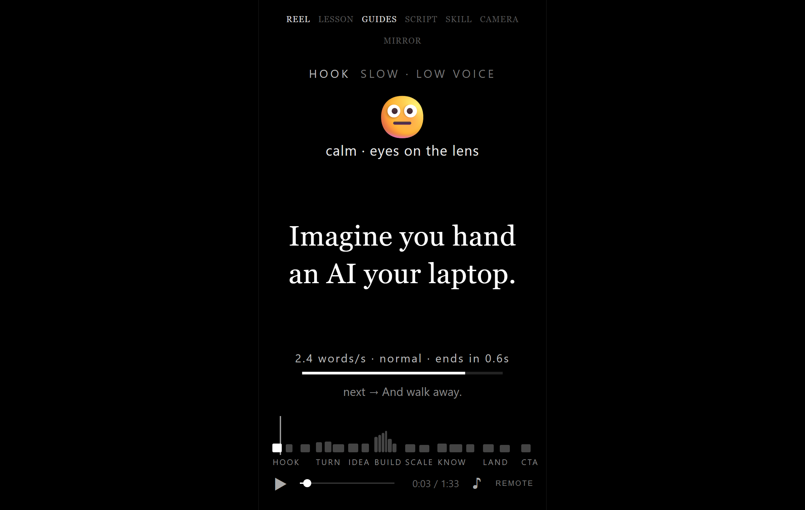
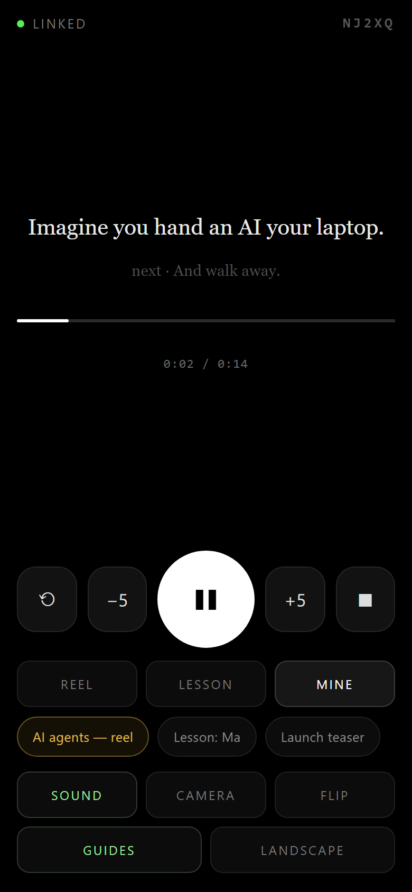
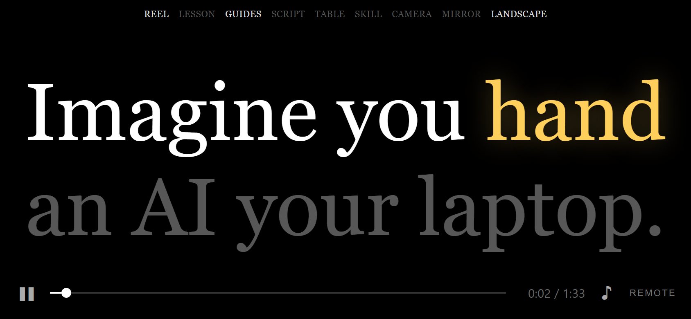
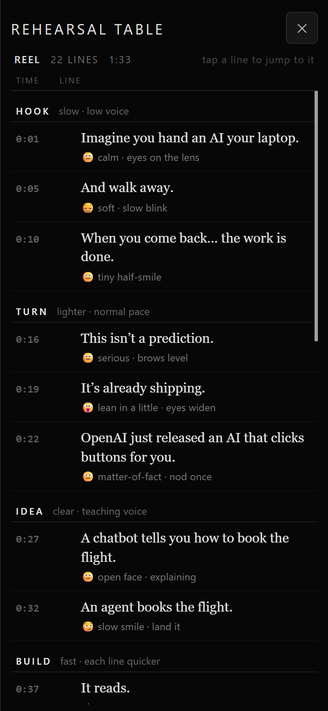

# 間 — Reel pacing · Remote control

Control the prompter from a second phone, tablet or laptop — **no account, no keys, and no need to be on the same Wi-Fi.**

Open **https://mdnadeemm.github.io/ma-prompter/** on both devices. That's the whole setup.

  
  

The file also runs offline: open `index.html` directly and pair with the code instead of the QR.

---

## Pair in 15 seconds

**On the prompter (the screen people read from)**

1. Tap **Remote** in the bottom-right corner.
2. Point the other device's camera at the **QR code** — the link opens and pairs itself.
3. No camera? Read the 5-character **room code** (e.g. `NAAUL`) and type it on the remote.

**On the remote (your phone)**

1. Scan the QR, or open the same page and tap **Remote → Use this device as the remote**, then type the code.
2. The dot turns green and says **linked**.

The code is remembered, so the next time both devices reconnect on their own.

---

## What the remote can do

| Control | Effect on the prompter |
|---|---|
| ▶ / ❚❚ (big button) | start / pause |
| ⟲ | back to the top and play |
| ■ | stop and rewind |
| −5 / +5 | jump 5 seconds |
| drag the progress bar | scrub to any point |
| Reel / Lesson / Mine | switch the script |
| Sound | mute the pulse sound |
| Camera | camera backdrop off → faint → strong |
| Flip | mirror the text (for a beam splitter) |
| Guides | hide/show the timing guides |
| Landscape | full-width stage with the biggest type that fits — for reading from far away |

The remote also shows the current line, the next line, the clock and the section, so you can read along.

Both devices stay in sync in both directions — if you tap the screen itself, the remote updates too.

---

## Read it from a distance

The normal stage is portrait-shaped, so on a phone propped up a few metres away the words are small. Tap **Landscape** in the top bar (or the **Landscape** chip on the remote) and the stage goes edge to edge and the type grows to the largest size that still fits the line — up to three lines, never breaking a word.

In this mode only the words remain: the face prompt, the speed readout, the progress line and the word map step aside. Spoken words stay white, words you have not reached yet drop to a third of their brightness, and the word you are on right now is gold — so from far away you can always see exactly where you are in the line. The mode bar and the controls fade out as usual and come back on a tap.

The choice is saved per device, so a phone that lives on a tripod comes back in landscape, and **W** toggles it from a keyboard.

  

---

## Rehearse first: the table

Tap **Table** in the top bar (or press **T**) for a rehearsal sheet of the whole script — one row per line with its **time**, the **line** itself, the **face / delivery** cue and how long it stays up (**show + pause**). Sections are grouped with their direction, e.g. *Build — fast · each line quicker*, so you can read the whole thing once and know where the voice changes before you start.

- Tap any row to jump the prompter to that line; it stays paused so you can read it, then tap the screen to play.
- The row for the line you are on is marked in gold and follows along while it plays.
- Lesson and custom scripts get the expression from their section direction when a line has no `face=`, so no row is ever empty.

  

---

## How it works

Both pages connect to a **public MQTT broker over WebSocket** (EMQX, with HiveMQ as a fallback):

- the room code picks a topic, `ma/<code>`
- the same code picks the broker, so two devices with the same code always meet
- the payload is XOR-obfuscated with the room code and base64-encoded

There is no server of yours, nothing to deploy, nothing to pay for.

> **Treat the room code like a password.** The obfuscation keeps the traffic unreadable to a casual observer on a public broker, but it is not real encryption. Anyone who knows the code can drive your screen. It only carries play/pause/seek and the current line — no personal data.

---

## Good to know

- **Works across networks** — phone on mobile data controlling a laptop at home is fine, as long as both have internet.
- **Latency** is roughly 100–300 ms. Fine for start/stop; not for precise frame timing.
- **Camera needs a secure page.** The hosted `https://` URL is fine; a local `file://` copy blocks the camera and the clipboard (the QR is hidden there too — pair with the code instead).
- **The screen stays awake** while the prompter or the remote is open (where the browser supports the Wake Lock API).
- **If the relay is blocked** (some sandboxed previews block WebSocket), the status says *no relay connection*. Open the file in a normal browser tab instead.
- If a device goes offline, commands sent meanwhile are queued and delivered on reconnect.

---

## Troubleshooting

| Symptom | Fix |
|---|---|
| Remote says *waiting for the screen* forever | the codes differ — tap the code at the top right of the remote and retype it |
| *no relay connection* on both | check internet access; corporate networks sometimes block `wss://` on port 8084 |
| Prompter turned into a remote by mistake | tap **Back to the prompter** on the code screen |
| Remote does nothing but says *linked* | the prompter tab is in the background — bring it to the front, browsers pause animation frames in hidden tabs |
